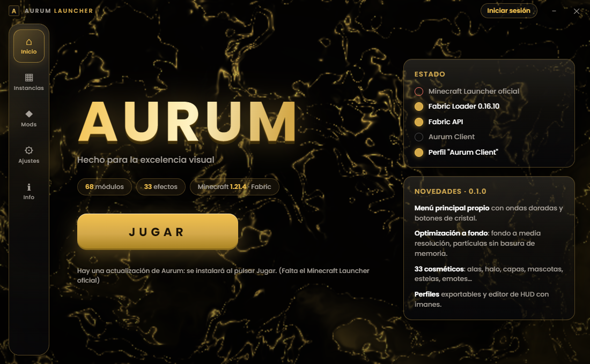
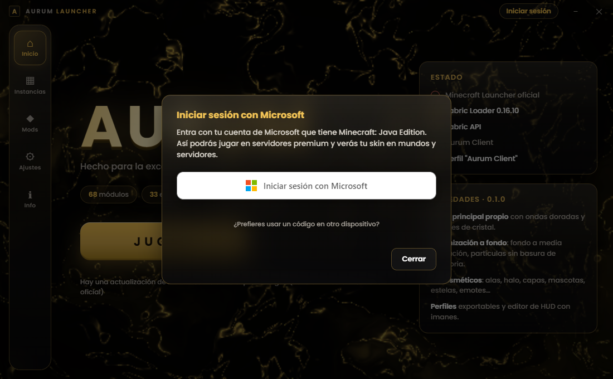
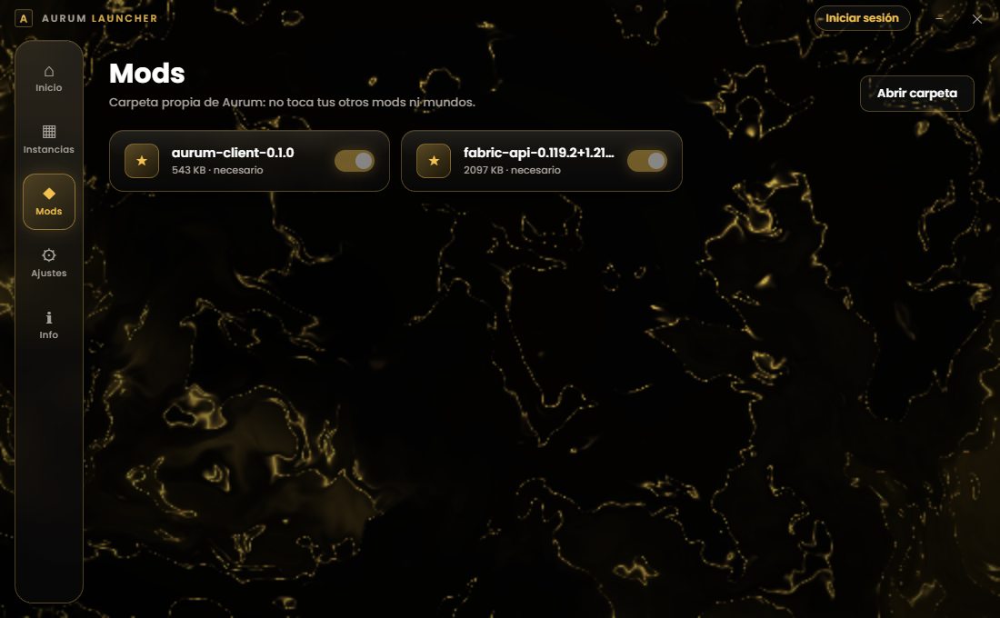

# Aurum Launcher

Free, public desktop launcher for **Minecraft: Java Edition** that installs [Fabric](https://fabricmc.net/) together with **Aurum Client**, our cosmetic / quality-of-life client mod, and starts the game with the player's own Microsoft account. Aurum Launcher is available to everyone.

## Download

Get the latest Windows installer from **[Releases](https://github.com/aaronleva08/aurum-launcher/releases/latest)**:

- `Aurum Launcher Setup x.y.z.exe`: installer (desktop shortcut, choose folder).
- `AurumLauncher-portable-x.y.z.exe`: portable, no install needed.

Requirements: Windows 10/11 (64-bit) and a Microsoft account that owns Minecraft: Java Edition.

## Supported versions

| Component | Versions |
|---|---|
| Aurum Client (mod) | **1.21.4** (Fabric Loader ≥ 0.16.10, Fabric API 0.119.2+1.21.4) |
| Launcher instances | Any Minecraft: Java Edition version: vanilla, Fabric, Quilt, Forge or NeoForge, plus mods, resource packs and shaders from Modrinth |

Support for more Minecraft versions in Aurum Client is planned.

## Microsoft account sign-in

Players click **Sign in with Microsoft** and that's it: no setup. The launcher uses the **official Microsoft OAuth 2.0 flow**:

1. **Microsoft** sign-in in the official Microsoft window (authorization code + PKCE), or with a device code at microsoft.com/link. The launcher never sees the user's password.
2. **Xbox Live** user token, then **XSTS** token for `rp://api.minecraftservices.com/`.
3. **Minecraft Services** `login_with_xbox` to get the game token, and `/minecraft/profile` to check that the user owns Minecraft: Java Edition and to show their name and skin.

Then the game is launched with that session.

**Privacy and security**

- Refresh tokens are stored **only on the user's PC**, encrypted with the operating system's secure storage (Windows DPAPI via Electron `safeStorage`).
- Game access tokens live only in memory and are renewed automatically.
- No token or account data is ever sent to any server of ours. We do not run any backend.
- Users must own Minecraft: Java Edition. Accounts without the game are rejected.

## Aurum Client (the mod)

Aurum Client is **100% legitimate**: everything it does is visual or informative and only on the player's own client. No Kill Aura, Reach, X-Ray, ESP, Freecam, auto-anything or any other gameplay advantage.

- **Interface:** "liquid glass" panels, animated background, searchable module menu, HUD editor, profiles.
- **Render:** Smooth Hotbar, Zoom, Freelook, Motion Blur, Better Tooltips, Block Highlight, Item Physics, and more.
- **HUD:** FPS, coordinates, ping, CPS, clock, armor and potion status, keystrokes, minimap (terrain only).
- **Cosmetics (visible only to you):** capes, wings, halo, pets, trails, particles, emotes.

## Launcher features

- Several Microsoft accounts, switch with one click.
- One-click install of Fabric Loader + Fabric API + Aurum Client.
- Instances with Modrinth search for mods, resource packs and shaders.
- RAM and garbage collector settings with tuned JVM flags.
- If no account is signed in, it falls back to the official Minecraft Launcher with an "Aurum" profile.

---

*Aurum is not affiliated with Mojang Studios or Microsoft. Minecraft is a trademark of Mojang Synergies AB.*
